# Image Processing Service

A Cloudinary-style image API: give it a public image URL and it resizes, crops and converts it. It comes with a web UI for exploring the API, a typed TypeScript SDK and interactive OpenAPI docs, and it is hardened for fetching untrusted URLs on the public internet.

- **API**: `GET /v1/process?url=…&width=…&height=…&format=…&quality=…&crop=…` (also at `/process`, so the brief's examples work verbatim)
- **UI**: `/`, an explorer showing the exact request, a curl snippet, and original vs processed side by side
- **Docs**: `/docs` (Swagger UI), `/openapi.json` (OpenAPI 3.1)
- **Live deployment**: not deployed (optional in the brief). The repo is deploy-ready: Dockerfile, health check and env-only config; see [Deployment](#deployment).

## Contents

- [Quick start](#quick-start)
- [Using the API](#using-the-api)
- [TypeScript SDK](#typescript-sdk)
- [Architecture overview](#architecture-overview)
- [Limits and safeguards](#limits-and-safeguards)
- [Testing and CI](#testing-and-ci)
- [Configuration](#configuration)
- [Deployment](#deployment)
- [Decisions and trade-offs](#decisions-and-trade-offs)
- [What I would do next](#what-i-would-do-next)

## Quick start

Requirements: Node 24 (see `.nvmrc`; 22.19+ works) and pnpm 12 (`corepack enable`).

```bash
pnpm install
pnpm dev            # API on http://localhost:3000, UI with hot reload on http://localhost:5173
```

Open <http://localhost:5173>, pick a sample, press **Process image**. The page URL always reflects the form, so any transformation can be shared as a link. Vite proxies API paths to `:3000`, so the UI is same-origin exactly as in production.

| Command                     | What it does                                                                                                                                    |
| --------------------------- | ----------------------------------------------------------------------------------------------------------------------------------------------- |
| `pnpm test`                 | Unit + integration tests (contract, API, SDK, UI)                                                                                               |
| `pnpm check`                | Everything CI's main job runs: format, lint, typecheck, build, tests with coverage gate                                                         |
| `pnpm test:e2e`             | Playwright: built UI + real API in Chromium, desktop and mobile. First run: `pnpm --filter @image-service/e2e exec playwright install chromium` |
| `pnpm build`                | Build all packages; then `node apps/api/dist/main.js` serves API + UI on <http://localhost:3000>                                                |
| `docker compose up --build` | Production-like hardened container on <http://localhost:3000> (`HOST_PORT=8080` to change)                                                      |

## Using the API

### Examples

```bash
# Resize (fits inside 500x300, keeping the aspect ratio)
curl -OJ 'http://localhost:3000/process?url=https://picsum.photos/id/237/1200/800.jpg&width=500&height=300'

# Convert PNG to JPEG at quality 80
curl -OJ 'http://localhost:3000/process?url=https://upload.wikimedia.org/wikipedia/commons/4/47/PNG_transparency_demonstration_1.png&format=jpeg&quality=80'

# Combine: exactly 800x600 WebP, cropped to fill
curl -OJ 'http://localhost:3000/v1/process?url=https://picsum.photos/id/237/1200/800.jpg&width=800&height=600&format=webp&crop=fill'

# See the error format
curl -s 'http://localhost:3000/v1/process?url=http://169.254.169.254/&widht=10' | jq
```

URL-encode the `url` value if it has its own query string (`url=https%3A%2F%2Fcdn.example.com%2Fa.png%3Fv%3D2`). The SDK and UI do this for you.

### Endpoints

| Method and path              | Purpose                                                                     |
| ---------------------------- | --------------------------------------------------------------------------- |
| `GET /v1/process`            | Fetch, transform and return an image (`HEAD` supported)                     |
| `GET /process`               | Alias of `/v1/process`, kept so the brief's examples work unchanged         |
| `GET /video/thumbnail`       | `501 NOT_IMPLEMENTED`: an explicit answer rather than a 404 (see Decisions) |
| `GET /healthz`               | Liveness check, `{"status":"ok"}`                                           |
| `GET /docs`, `/openapi.json` | Swagger UI and the OpenAPI 3.1 document                                     |
| `GET /`                      | The web UI                                                                  |

### Parameters

| Param     | Values                                       | Default       | Notes                                                                                               |
| --------- | -------------------------------------------- | ------------- | --------------------------------------------------------------------------------------------------- |
| `url`     | public `http`/`https` URL, ≤ 2048 chars      | required      | Ports 80/443 only; private and internal addresses are refused (see [SSRF](#source-url-policy-ssrf)) |
| `width`   | integer 1–4000                               |               | With one dimension only, the other keeps the aspect ratio                                           |
| `height`  | integer 1–4000                               |               |                                                                                                     |
| `format`  | `jpeg` (`jpg`), `png`, `webp`, `avif`, `gif` | source format | Case-insensitive. TIFF sources default to PNG                                                       |
| `quality` | integer 1–100                                | 80            | JPEG, WebP, AVIF. A `400` if combined with an explicit `format=png`/`gif`                           |
| `crop`    | `fit`, `fill`, `limit`, `pad`, `scale`       | `fit`         | `fill`, `pad` and `scale` need both `width` and `height`                                            |

| `crop`  | Behaviour with `width` × `height`                                      |
| ------- | ---------------------------------------------------------------------- |
| `fit`   | Fit inside the box, keep the aspect ratio (may upscale)                |
| `fill`  | Cover the box exactly, cropping the overflow from the centre           |
| `limit` | Like `fit`, but never upscale                                          |
| `pad`   | Fit inside, then pad to the exact box (transparent, or white for JPEG) |
| `scale` | Stretch to exactly the box, ignoring the aspect ratio                  |

Unknown or repeated parameters are rejected (`widht` gets _Did you mean "width"?_), and every invalid parameter is reported in one response.

Output is auto-oriented from EXIF, has **all metadata stripped** (GPS, camera, author), and uses only the first frame of animated sources.

### Response headers

| Header                               | Meaning                                                                      |
| ------------------------------------ | ---------------------------------------------------------------------------- |
| `Content-Type`, `Content-Length`     | Output format and size                                                       |
| `X-Output-Width`, `X-Output-Height`  | Output dimensions                                                            |
| `X-Source-Width/Height/Format/Bytes` | The original, as detected (the UI uses these for its side-by-side view)      |
| `ETag`, `Cache-Control`              | Strong validator (send `If-None-Match` for a `304`), `public, max-age=86400` |
| `X-Cache`                            | `HIT` or `MISS` for the server's result cache                                |
| `Content-Disposition`                | `inline; filename="cat.webp"`, derived from the source path                  |
| `X-Request-Id`                       | Correlates with server logs; also in error bodies                            |
| `RateLimit`, `RateLimit-Policy`      | Remaining quota (IETF draft-8 format)                                        |

All of these are exposed via CORS, so browser clients on other origins can read them.

### Errors

Every error is [RFC 9457](https://www.rfc-editor.org/rfc/rfc9457) `application/problem+json` with a stable `code` to branch on, a `detail` that says what to fix, per-parameter `errors` and the `requestId`:

```json
{
  "type": "urn:image-service:problem:invalid-parameter",
  "title": "Invalid request parameter",
  "status": 400,
  "detail": "2 parameters are invalid: width, crop. See \"errors\" for details.",
  "code": "INVALID_PARAMETER",
  "instance": "/v1/process",
  "requestId": "4ffa1070-6a6e-4f0f-84f8-751bac584ef5",
  "errors": [
    { "param": "width", "message": "width must be between 1 and 4000" },
    {
      "param": "crop",
      "message": "crop=fill needs both width and height; add the missing one or use crop=fit"
    }
  ]
}
```

| Status | `code`                                      | When                                                                      |
| ------ | ------------------------------------------- | ------------------------------------------------------------------------- |
| 400    | `INVALID_PARAMETER`                         | Bad, unknown or duplicated parameters; a resize that would exceed 4000 px |
| 400    | `URL_NOT_ALLOWED`                           | Scheme, credentials, port, private/internal address, `ALLOWED_HOSTS`      |
| 404    | `NOT_FOUND`                                 | Unknown route                                                             |
| 405    | `METHOD_NOT_ALLOWED`                        | Anything but `GET`/`HEAD` (with an `Allow` header)                        |
| 413    | `SOURCE_TOO_LARGE`                          | Source file over 15 MB                                                    |
| 415    | `UNSUPPORTED_MEDIA_TYPE`                    | Not JPEG/PNG/WebP/AVIF/GIF/TIFF (e.g. an HTML page, SVG, PDF, HEIC)       |
| 422    | `IMAGE_TOO_LARGE`, `PROCESSING_FAILED`      | Over 40 megapixels; corrupt or truncated file                             |
| 429    | `RATE_LIMITED`                              | Per-client limit hit (`Retry-After` says when to retry)                   |
| 500    | `INTERNAL`                                  | Bug; details are logged, never returned                                   |
| 501    | `NOT_IMPLEMENTED`                           | Video thumbnails                                                          |
| 502    | `SOURCE_FETCH_FAILED`, `TOO_MANY_REDIRECTS` | Upstream error status, DNS or connection failure, more than 3 redirects   |
| 503    | `SERVER_BUSY`                               | Processing queue full (`Retry-After`)                                     |
| 504    | `SOURCE_TIMEOUT`                            | Source slower than 10 s                                                   |

Upstream failures are `502`, not the upstream's own status: a `404` from us would wrongly suggest our route is missing. The upstream status is named in `detail`.

## TypeScript SDK

[`packages/sdk`](packages/sdk/src/client.ts) is what the UI uses, and what a third-party TypeScript consumer would install.

```ts
import { ImageApiError, ImageClient } from '@image-service/sdk';

const images = new ImageClient({ baseUrl: 'https://img.example.com' });

// Build a validated URL for  (no request made). Same rules and messages as the server.
const src = images.url({ url: 'https://example.com/cat.jpg', width: 400, format: 'webp' });

// Or fetch it and get details back.
try {
  const result = await images.process({ url: 'https://example.com/cat.jpg', width: 400 });
  result.blob; // the image
  result.width; // 400 (output size); result.source.width etc. for the original
} catch (error) {
  if (error instanceof ImageApiError) {
    error.code; // 'URL_NOT_ALLOWED' | 'RATE_LIMITED' | 'NETWORK_ERROR' | ...
    error.errors; // per-parameter problems for form fields
    if (error.isRetryable) setTimeout(retry, (error.retryAfterSeconds ?? 1) * 1000);
  }
}
```

- **Fails fast locally**: invalid options throw before any request, listing every problem with the server's own messages (it runs the same validator), including typos from untyped JS callers.
- **One error type**: server problems, non-JSON error pages from proxies (`UNEXPECTED_RESPONSE`) and network failures (`NETWORK_ERROR`) are all `ImageApiError` with `code`, `status`, `errors`, `requestId`, `isRetryable` and `retryAfterSeconds`. Aborts pass through as the original `AbortError`, so they are easy to ignore.
- **Works in browsers and Node 18+** (global `fetch`), with an injectable `fetch` for retries, tracing or tests.
- An integration test runs the real SDK against the real server over HTTP, so header names and error bodies cannot drift apart.

Packaging note: the SDK depends on the workspace `contract` package (and through it on `zod`, ~15 KB gzipped). Publishing to npm would mean bundling `contract` into the SDK build; not done since nothing is published.

## Architecture overview

```mermaid
flowchart LR
  client["UI / SDK / curl"] -->|"GET /v1/process"| mw["helmet, CORS,<br/>request id, logging"]
  mw --> rl["Per-IP rate limit"]
  rl --> val["Validate params<br/>(shared contract)"]
  val --> pol["URL policy"]
  pol --> cache{"Result cache"}
  cache -->|HIT| resp["Image + ETag,<br/>Cache-Control, X-* headers"]
  cache -->|MISS| sf["Single-flight<br/>(coalesce duplicates)"]
  sf --> lim["Concurrency limiter<br/>(503 when full)"]
  lim --> fetch["Fetcher: pinned DNS,<br/>manual redirects, size cap, timeouts"]
  fetch --> sniff["Sniff format,<br/>pixel budget"]
  sniff --> sharp["sharp: orient, resize,<br/>encode, strip metadata"]
  sharp --> store["Store in cache"] --> resp
```



**Packages** (pnpm workspaces):

| Path                                     | What                                                                                                                                             |
| ---------------------------------------- | ------------------------------------------------------------------------------------------------------------------------------------------------ |
| [`packages/contract`](packages/contract) | Parameter schema and validator, limits, formats, crop modes, error catalogue. Single source of truth.                                            |
| [`apps/api`](apps/api)                   | Express 5 service. `security/` SSRF layers, `fetch/` fetcher, `image/` pipeline, `process/` cache, coalescing and limiter, `routes/`, `openapi/` |
| [`packages/sdk`](packages/sdk)           | Typed client used by the UI and third parties                                                                                                    |
| [`apps/web`](apps/web)                   | React + Vite UI (plain CSS, light/dark, responsive); talks to the API only through the SDK                                                       |
| [`e2e`](e2e)                             | Playwright suite and a hermetic test harness                                                                                                     |

The contract package is why validation is consistent everywhere: the API, the SDK (before sending), the UI (live, as you type) and the OpenAPI document all derive from it. In production, the API process also serves the built UI, so there is one deployable unit and one origin.

## Limits and safeguards

| Limit            | Default                                       | Env                                               | Why                                                                                                                          |
| ---------------- | --------------------------------------------- | ------------------------------------------------- | ---------------------------------------------------------------------------------------------------------------------------- |
| Source file size | 15 MB                                         | `MAX_SOURCE_BYTES`                                | Covers high-res photos (a 24 MP JPEG is ~8–12 MB); caps per-request memory. Checked on `Content-Length` and while streaming. |
| Fetch deadline   | 10 s total (connect 3 s, headers 5 s)         | `FETCH_TIMEOUT_MS`                                | Slow or trickling upstreams cannot pin a worker; well inside the 30 s inbound request timeout.                               |
| Redirects        | 3                                             | `MAX_REDIRECTS`                                   | Enough for http→https→CDN chains; every hop re-validated.                                                                    |
| Input pixels     | 40 MP                                         | `MAX_INPUT_PIXELS`                                | Decoded RGBA at 40 MP is ~160 MB; decompression bombs are refused from the header, before decoding.                          |
| Output size      | 4000 px per side                              | (contract constant)                               | Bounds encode cost; shared by API, SDK and UI validation.                                                                    |
| Processing time  | 10 s per image                                | `PROCESSING_TIMEOUT_SECONDS`                      | libvips pipeline timeout for pathological inputs.                                                                            |
| Concurrency      | 4 jobs, 20 queued                             | `PROCESSING_CONCURRENCY`, `PROCESSING_QUEUE_SIZE` | About the CPU cores of a small instance; beyond the queue, a fast `503` + `Retry-After` rather than everyone slowing down.   |
| Rate limit       | 60 requests/min per client IP                 | `RATE_LIMIT_PER_MINUTE`                           | Plenty for interactive use, stops scripted hammering. Only processing routes are limited.                                    |
| Result cache     | 128 MB, 1 h TTL, ≤ 1/8 of budget per entry    | `CACHE_MAX_BYTES`, `CACHE_TTL_SECONDS`            | Bounded memory; one huge result cannot flush the cache. `0` disables it.                                                     |
| HTTP caching     | `public, max-age=86400`, strong `ETag`, `304` |                                                   | Browsers and CDNs absorb repeats. Not `immutable`, because sources can change. Errors are `no-store`.                        |
| URL length       | 2048 chars                                    | (contract constant)                               | Sanity bound (cache keys are SHA-256 hashes regardless).                                                                     |
| Inbound request  | headers 10 s, request 30 s, keep-alive 5 s    |                                                   | Slow-client (slowloris) protection on our own socket.                                                                        |

### Source URL policy (SSRF)

The service fetches URLs chosen by anyone, so every source URL, and every redirect target, passes three layers:

1. **Static URL checks** ([`url-policy.ts`](apps/api/src/security/url-policy.ts)): `http`/`https` only; no embedded credentials; ports 80/443 only; IP literals must be public (WHATWG parsing first normalises tricks like `2130706433`, `0x7f.1`, `0177.0.0.1`); internal-looking names are rejected (`localhost`, `*.local`, `*.internal`, `*.home.arpa`, `*.lan`, and single-label names such as `metadata` or `redis`); optional `ALLOWED_HOSTS` allowlist.
2. **Address allowlist** ([`ip-policy.ts`](apps/api/src/security/ip-policy.ts)): only globally routable unicast addresses pass. That blocks private, loopback, link-local (including `169.254.169.254` cloud metadata), CGNAT, reserved/documentation, multicast, and IPv6 transition ranges (6to4, Teredo, NAT64) that can wrap an internal IPv4. IPv4-mapped IPv6 is unwrapped and re-checked. Allowlisting rather than blocklisting means new or forgotten special ranges fail closed.
3. **Connect-time DNS pinning** ([`pinned-lookup.ts`](apps/api/src/security/pinned-lookup.ts)): the socket's own DNS lookup validates every resolved record and connects to exactly the address it checked. This defeats DNS rebinding (resolve public for the check, private for the connection). If any record for a host is non-public, the whole host is refused.

Verified live: `127.0.0.1.nip.io` (public DNS pointing at loopback) is refused at connect time. There is deliberately no environment flag to disable any of this; tests inject a fake resolver instead.

### Fetching the source

[`fetcher.ts`](apps/api/src/fetch/fetcher.ts) downloads with `undici` through the pinned lookup:

- **Redirects** are followed manually (301/302/303/307/308, max 3), and every target is re-validated by both the URL policy and DNS pinning.
- **Size cap** is enforced twice: an oversized `Content-Length` is rejected before reading, and the stream is cut as soon as it passes the limit (servers can lie about or omit the length).
- **Timeouts**: connect, time-to-headers, and one total deadline covering all redirects and the body.
- **No compression**: `Accept-Encoding: identity`, and compressed bodies are refused rather than inflated (decompression-bomb risk, no benefit for images).
- **No ambient authority**: client cookies and headers are never forwarded; proxy environment variables are not used.
- **Only `200` counts as success**; errors never echo resolved internal IP addresses.

### Processing the image

[`pipeline.ts`](apps/api/src/image/pipeline.ts) (sharp/libvips) checks cheap things first and decodes last:

1. **Format from bytes, not headers** ([`detect.ts`](apps/api/src/image/detect.ts)): magic-byte sniffing admits only JPEG, PNG, WebP, AVIF, GIF and TIFF. `Content-Type` and extensions are ignored (attacker-controlled). SVG, HTML/XML, PDF and HEIC get a specific `415` _before_ libvips sees them, so its SVG/PDF loaders are unreachable.
2. **Pixel budget from the header**: a 70-byte PNG claiming 100000×100000 is refused in milliseconds; `limitInputPixels` is set on the decoder as a second guard.
3. **Output size planned before any work**: `width=4000` on a 10×1000 image (4000×400000) is a `400` naming the parameter to change.
4. **Transform**: EXIF auto-orientation, resize per crop mode, encode. JPEG output flattens transparency onto white (libvips would otherwise produce black).
5. **Privacy**: all metadata is stripped from output.
6. **Time limit** per libvips pipeline. libvips' own operation cache is disabled; results are cached at the HTTP layer with a byte budget instead.

### Caching and request coalescing

[`service.ts`](apps/api/src/process/service.ts) checks the result cache first. On a miss, concurrent identical requests (same normalised URL and parameters) share one in-flight job, so a burst costs one fetch and one encode. The shared job is not tied to any single client connection: if the first caller disconnects, the others still get the result and the cache is warmed. Failures are never cached. The cache sits behind an async `ResultCache` interface, so Redis or a CDN origin cache can replace it without touching callers. The UI reports where each result came from: the browser's HTTP cache (detected via Resource Timing), the server's result cache (`X-Cache: HIT`), or freshly processed.

### Rate limiting and client identity

[`rate-limit.ts`](apps/api/src/http/rate-limit.ts) keys on `req.ip`, so what counts as "the client" depends on `TRUST_PROXY`:

- Default `false`: the socket address. `X-Forwarded-For` is ignored, so clients cannot rotate it to escape the limit (express-rate-limit logs a warning if the header appears, a hint that you are behind a proxy and forgot to configure it).
- Behind a load balancer: set the hop count (`1` on most platforms) or the proxy IPs/CIDRs.
- `true` (trust every hop) is refused at startup.

IPv6 clients are bucketed per /56. Counters live in memory, per instance.

### HTTP hardening

- `helmet` security headers with a CSP stricter than helmet's defaults (no inline or third-party styles). The UI and `/docs` each get a page-specific policy, relaxed only as far as they need: image previews from `http(s):`/`blob:`, and inline styles for Swagger UI. The e2e suite fails on any CSP violation.
- `Cross-Origin-Resource-Policy: cross-origin` so other sites can embed processed images; CORS is `GET`/`HEAD` only.
- Request IDs are reused from upstream proxies only if they match a safe pattern (no log or header injection); cookies and `Authorization` are redacted from logs; 500s never expose internals.
- Env config is validated at startup (the process refuses to start half-configured); graceful `SIGTERM` drain.

### Supply chain

pnpm `allowBuilds` explicitly denies dependency install scripts (including `@scarf/scarf` telemetry pulled in by Swagger UI); pnpm's minimum release age is respected, with no bypasses; frozen lockfile in CI and Docker; GitHub Actions pinned to commit SHAs with a read-only token; Docker base image pinned by digest.

## Testing and CI

| Layer       | Where                                             | What it proves                                                                                                                                                                   |
| ----------- | ------------------------------------------------- | -------------------------------------------------------------------------------------------------------------------------------------------------------------------------------- |
| Unit        | `*/test/**` (Vitest)                              | Validation rules, SSRF policy tables, fetcher limits against a scripted server, image pipeline on generated fixtures, cache/limiter/coalescing, SDK error mapping, UI components |
| Integration | `apps/api/test/routes`, `sdk.integration.test.ts` | Full HTTP stack through the real fetcher and SSRF lookup; the real SDK against the real server                                                                                   |
| End-to-end  | `e2e/` (Playwright)                               | The built UI bundle served by the real API in Chromium (desktop and mobile): processing, copy-as-curl, validation, blocked URL, unsupported file, docs page, no CSP violations   |

547 unit and integration tests at ~99% line coverage (CI gate: 90% lines, 85% branches), plus 14 browser tests. Tests are hermetic: a local "upstream" server plays the internet under fake hostnames (`img.test`) resolved by an injected DNS function; the SSRF protections themselves are never switched off. Security-critical code was mutation-checked by hand (breaking each guard and confirming a test fails).

[`.github/workflows/ci.yml`](.github/workflows/ci.yml) runs three jobs on every push to `main` and every pull request: the `pnpm check` steps, the Playwright suite (report uploaded on failure), and a Docker job that builds the image, boots it with the hardening flags, and waits for the health check. Actions are SHA-pinned, the token is read-only, checkout credentials are not persisted, and the workflow passes actionlint.

## Configuration

All settings come from environment variables (see [`.env.example`](.env.example)). They are validated at startup; invalid values stop the process with a list of every problem. There are no secrets.

| Variable                | Default                              | Notes                                                                                                  |
| ----------------------- | ------------------------------------ | ------------------------------------------------------------------------------------------------------ |
| `NODE_ENV`              | `development`                        | `development`, `production` or `test`                                                                  |
| `HOST`, `PORT`          | `0.0.0.0`, `3000`                    |                                                                                                        |
| `LOG_LEVEL`             | `info`                               | pino level; JSON logs on stdout with a `req.id` field                                                  |
| `ALLOWED_HOSTS`         | _(empty)_                            | Comma-separated source host allowlist, `*.example.com` for subdomains. Empty = any public host         |
| `RATE_LIMIT_PER_MINUTE` | `60`                                 | Per client IP on processing routes; `0` disables                                                       |
| `TRUST_PROXY`           | `false`                              | Proxy hop count or IPs/CIDRs used to find the client IP; `true` is refused                             |
| `STATIC_DIR`            | _(auto)_                             | Built UI to serve at `/`; defaults to `apps/web/dist` when built, otherwise API-only                   |
| Resource limits         | see [Limits](#limits-and-safeguards) | `MAX_SOURCE_BYTES`, `FETCH_TIMEOUT_MS`, `MAX_REDIRECTS`, `MAX_INPUT_PIXELS`, `PROCESSING_*`, `CACHE_*` |

## Deployment

**Not deployed.** Deployment was optional in the brief and deferred; everything needed to deploy is in the repo.

The [`Dockerfile`](Dockerfile) is multi-stage: frozen-lockfile install, build every workspace, then `pnpm deploy --prod` copies only the API's production dependencies plus the built UI into a clean runtime stage. The runtime image (~93 MB) has a digest-pinned base, no package manager, sources or dev dependencies, runs as the unprivileged `node` user with root-owned read-only application files, and has a `HEALTHCHECK` on `/healthz`. [`compose.yaml`](compose.yaml) adds a read-only root filesystem, dropped Linux capabilities, `no-new-privileges`, an init process and a memory limit.

To deploy on any container host (Fly.io, Render, Railway, Cloud Run):

1. Point the platform at this repository's `Dockerfile`; expose port `3000`.
2. Use `GET /healthz` as the health check.
3. Set `TRUST_PROXY=1` (the platform's load balancer is one hop) so rate limiting sees real client IPs.
4. Optionally set `ALLOWED_HOSTS` and tune the limits for the instance size.

Scale-to-zero free tiers would add a cold start (Node boot is under a second; the first sharp call warms libvips).

## Decisions and trade-offs

Every scope call made while building, with the reasoning. "Skipped" items are deliberate, not forgotten.

| #   | Area            | Decision                                                                                              | Why                                                                                                                                                                         |
| --- | --------------- | ----------------------------------------------------------------------------------------------------- | --------------------------------------------------------------------------------------------------------------------------------------------------------------------------- |
| 1   | Language        | TypeScript (strict) everywhere                                                                        | The brief's stated preference; one set of parameter types shared by API, SDK and UI.                                                                                        |
| 2   | TS version      | TypeScript 6.0, not 7                                                                                 | `typescript-eslint` does not support TS 7 yet (peer range `<6.1`). Type-aware linting is worth more than the newer compiler here.                                           |
| 3   | API framework   | Express 5 + zod                                                                                       | Familiar; async errors handled natively in v5. zod powers the shared parameter validator.                                                                                   |
| 4   | Repo shape      | pnpm workspaces monorepo                                                                              | API, SDK, UI and shared contract evolve together; one install, one test command.                                                                                            |
| 5   | Errors          | RFC 9457 `application/problem+json` with stable `code`, per-field `errors[]` and `requestId`          | A standard shape any HTTP client understands; `code` gives SDK users something stable to branch on.                                                                         |
| 6   | Crop modes      | Cloudinary names `fill`, `fit`, `limit`, `pad`, `scale`; default `fit`                                | Matches the "Cloudinary-style" brief and its `crop=fill` example. The default deviates from Cloudinary (`scale` stretches) so images never distort unless asked.            |
| 7   | Cache           | In-memory, byte-capped LRU + `Cache-Control`/`ETag`                                                   | Zero infrastructure; the interface allows swapping in Redis or a CDN. Per-instance and lost on restart.                                                                     |
| 8   | Abuse           | Per-IP rate limit + global processing concurrency cap                                                 | Cheap and effective for one instance. Signed URLs/API keys skipped: they would block the "explore without docs" UI flow.                                                    |
| 9   | UI hosting      | Vite build served by Express                                                                          | One deploy unit, one origin. The UI still talks to the public API through the SDK.                                                                                          |
| 10  | Bonus scope     | Typed SDK + OpenAPI docs, CI pipeline                                                                 | Directly target "SDK mindset" and "API design"; CI is cheap proof the tests run.                                                                                            |
| 11  | OpenAPI         | Spec generated from contract constants, not zod-to-openapi                                            | The query schemas parse strings into numbers, so generated docs would say `width: string ^\d+$`. Drift tests fail if spec and code disagree.                                |
| 12  | Docs UI         | Swagger UI self-hosted at `/docs`                                                                     | No third-party CDN; CSP relaxed only on `/docs`.                                                                                                                            |
| 13  | CSP             | Stricter than helmet's defaults; no `upgrade-insecure-requests`                                       | Defaults allow inline styles; the upgrade directive breaks plain-http local runs and http source previews. HSTS covers https.                                               |
| 14  | Upstream status | Only `200` counts as success                                                                          | A `206` would mean processing (and caching) a truncated image; `204`/`202` carry no usable image. Fails loudly, naming the upstream status.                                 |
| 15  | Compression     | Request `identity`, reject compressed bodies                                                          | Inflating attacker-controlled bodies is a decompression-bomb vector; images are already compressed.                                                                         |
| 16  | Coalescing      | A shared in-flight job is not cancelled when one client disconnects                                   | Other waiters still get a result and the cache warms; worst-case waste is bounded by timeouts.                                                                              |
| 17  | Resize overflow | `400` naming the parameter, not silent clamping                                                       | Telling the caller beats surprising them.                                                                                                                                   |
| 18  | Proxy trust     | `TRUST_PROXY=true` refused at startup                                                                 | Trusting every hop lets clients spoof `X-Forwarded-For` and escape the rate limit.                                                                                          |
| 19  | HEIC            | Rejected with a specific `415`                                                                        | Needs a patent-encumbered decoder; not in the brief.                                                                                                                        |
| 20  | Supply chain    | `allowBuilds` deny-list, no release-age bypasses, SHA-pinned actions, digest-pinned image             | Install scripts and day-old releases are the usual npm attack paths.                                                                                                        |
| 21  | Output headers  | Added `X-Output-Width/Height`                                                                         | The UI and SDK need processed dimensions; parsing image bytes client-side would be worse.                                                                                   |
| 22  | UI trigger      | Explicit **Process** button; request URL previews live                                                | Predictable, one request per click, easy on the rate limit; you can read the URL before sending.                                                                            |
| 23  | UI styling      | Plain CSS, no UI library                                                                              | No dependencies, CSP-safe (no inline styles); light/dark and responsive.                                                                                                    |
| 24  | Base image      | Debian slim, not Alpine or distroless                                                                 | sharp's prebuilt binaries target glibc; slim keeps a shell for debugging at ~93 MB.                                                                                         |
| 25  | E2E isolation   | Test-only harness injects DNS; Chromium maps `img.test` to loopback                                   | Hermetic browser tests without an internet dependency or a production backdoor.                                                                                             |
| 26  | Shareable state | The page URL mirrors the form (`/?url=…&width=600`); links auto-process, reload and Back/Forward work | Found during browser testing: reload lost everything. The first edit after a result pushes a history entry and later keystrokes replace it, so typing never floods history. |
| 27  | curl snippet    | `curl -fo processed.<ext> '…'` instead of `-OJ`                                                       | Found during browser testing: `-J` refuses to overwrite, so re-running the snippet failed with "File exists".                                                               |
| 28  | Upstream 429    | Kept as `502 SOURCE_FETCH_FAILED` with a specific "source is rate-limiting this service" detail       | Seen live with Wikimedia; a clear message without a contract change.                                                                                                        |

### Skipped on purpose

| Item                        | Why                                                                                                                                                  |
| --------------------------- | ---------------------------------------------------------------------------------------------------------------------------------------------------- |
| Video thumbnails            | Needs ffmpeg, and ffmpeg on untrusted input has its own SSRF/local-file-read surface (HLS, concat). 2–3 h for low value. The endpoint returns `501`. |
| SVG and HEIC input          | XML renderer attack surface; patent-encumbered codec.                                                                                                |
| Animated output             | Frames × pixels blows the CPU/memory budget; the first frame is used.                                                                                |
| Signed URLs / API keys      | See decision 8.                                                                                                                                      |
| Distributed cache / limiter | Single-instance scope; Redis is the next step for horizontal scaling.                                                                                |
| Metrics endpoint            | Structured logs with request IDs and response times are in; aggregated metrics are not (see next steps).                                             |
| Deployment                  | Optional in the brief; deferred. Built deploy-ready.                                                                                                 |

## What I would do next

In priority order:

1. **Deploy behind a CDN.** Fly.io or Render with `TRUST_PROXY=1`, fronted by a CDN that honours our `Cache-Control`/`ETag`, so repeat requests never reach the origin.
2. **Shared state for more than one instance.** Redis (or Cloudflare KV/Upstash) for rate-limit counters and in-flight coordination; object storage (S3/R2) for processed results, keyed by the existing SHA-256 cache key.
3. **Abuse and cost controls for real tenants.** API keys with per-key quotas and HMAC-signed URLs (Cloudinary's `s--…--` model), keeping an anonymous, tightly limited demo tier for the UI.
4. **Process isolation and egress control.** Run sharp in worker threads or a separate process with its own memory limit, so a pathological image cannot stall the event loop. Route all source fetches through a dedicated egress proxy (e.g. Stripe's smokescreen) as a network-level SSRF backstop.
5. **Observability.** OpenTelemetry traces splitting fetch vs processing time; metrics for latency, cache hit rate and error rate by `code`; dashboards and alerts on `5xx` and `SERVER_BUSY`.
6. **Load testing.** k6 against realistic image mixes, to tune concurrency, queue size and cache budget per instance size instead of reasoned defaults.
7. **More transformations.** `format=auto` via `Accept` (with `Vary: Accept` and cache-key care), `gravity` for `fill`, `background` for `pad`, `dpr`, rotate/blur/grayscale.
8. **SDK distribution.** Publish to npm with `contract` bundled; generate clients for other languages from the OpenAPI document.
9. **Broader browser coverage.** Firefox and WebKit in the e2e matrix, plus visual regression snapshots of the UI.
